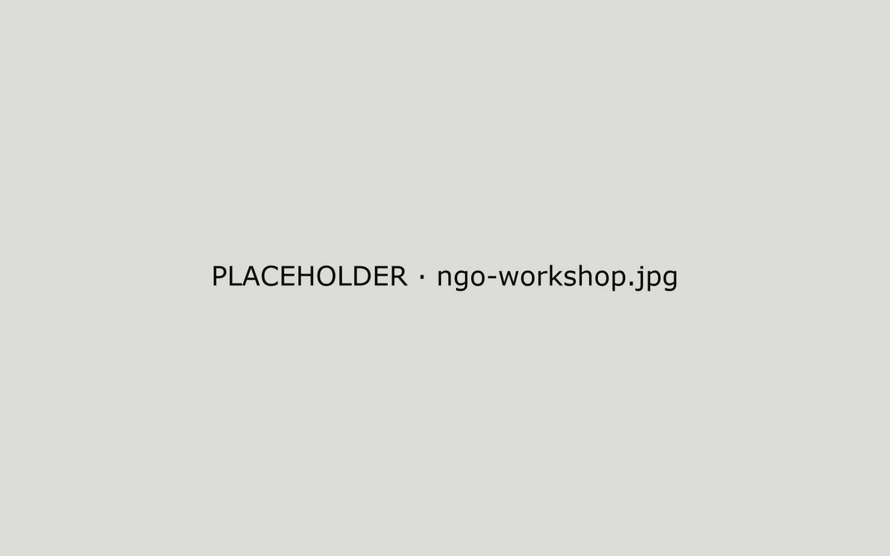
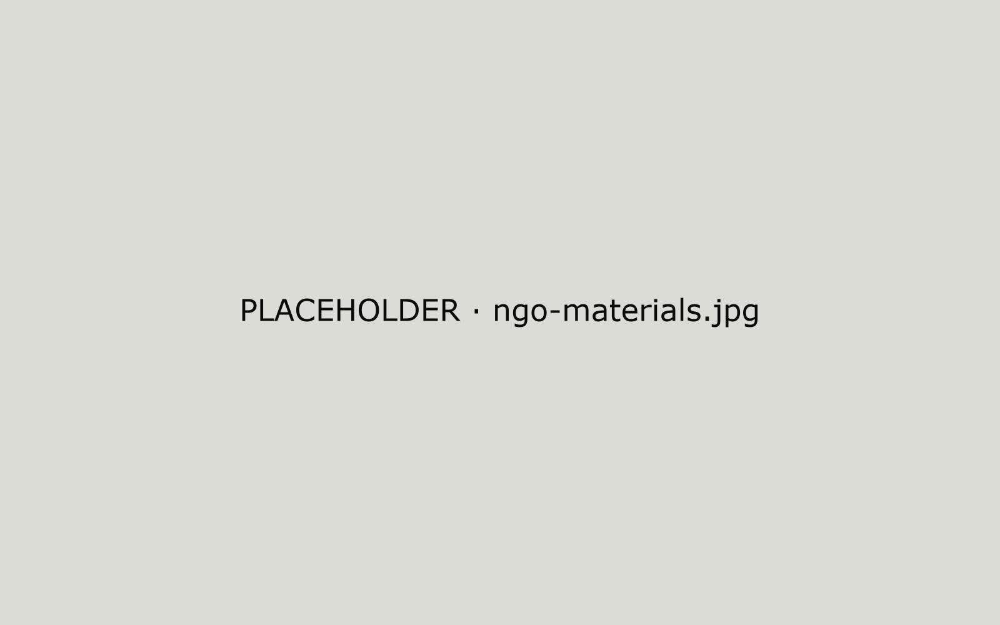
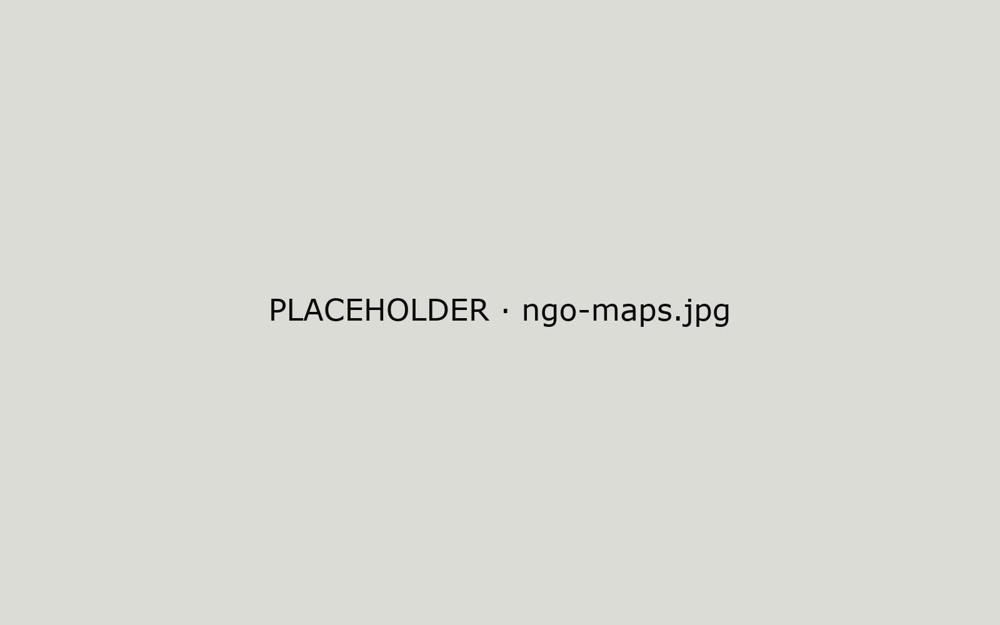

## Context

I worked as UX Lead on a discovery project for an international non-profit working to establish standards for sustainable fishing. The organisation works with a wide range of people and organisations — from fisheries and supply-chain partners to researchers, journalists and NGOs — and relies on data, certification processes and long-term relationships to achieve its aims.

The project began by asking how its digital systems could better support those relationships. At the time, the organisation was developing its CRM and dealing with data and processes that had grown across different teams and systems.

## Approach

My role was to understand how those relationships worked across the organisation and make them visible. I co-designed and facilitated a series of full-day workshops with senior staff from different departments, mapping how they worked with different stakeholder groups over time: what information was exchanged, which systems and processes were involved, and where people encountered problems or opportunities.

## Seven experience maps

I brought this material together into seven detailed experience maps, each representing a different stakeholder group. Rather than describing a single user journey through an interface, the maps showed the relationship between people, organisational processes, data and digital touchpoints over time. I took them back into follow-up sessions where they were reviewed, challenged and refined with the people who understood those relationships first-hand.

## What changed

The project changed while we were doing it. A broader digital transformation programme was reconsidered, which meant the original brief no longer made sense in quite the same way. Rather than continuing towards a predetermined solution, we used the research and maps to help the organisation reassess what it needed. They gave teams a shared view of relationships and data that had previously been understood separately, and a way to discuss where digital change might actually be useful.
